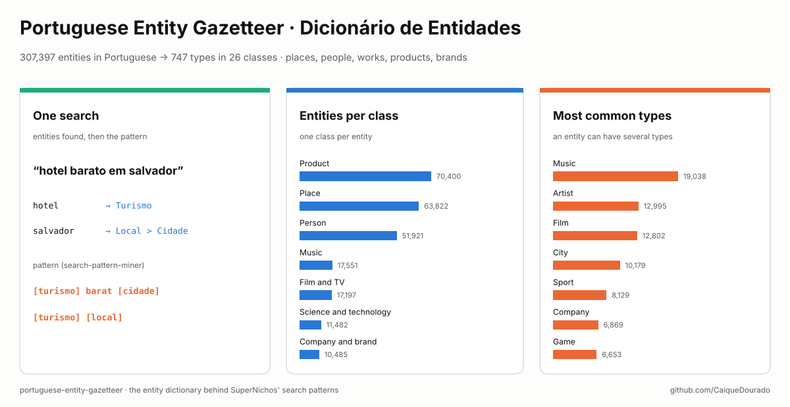
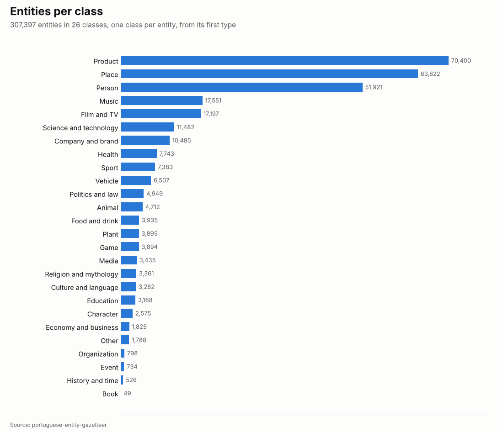
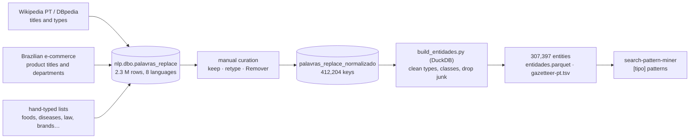

# Portuguese Entity Gazetteer · Dicionário de Entidades do Português

[](https://github.com/CaiqueDourado/portuguese-entity-gazetteer/actions/workflows/validate.yml)
[](LICENSE-DATA.md)
[](LICENSE)
[](https://www.kaggle.com/datasets/caiquedourado/portuguese-entity-gazetteer)

[Leia em português](README.pt-BR.md)



A list of **307,397 entities in Portuguese** with their types: places, people, films, songs, TV shows, products,
brands, foods, diseases, laws, animals, plants… Each entity has **one or more of 747 types** (*Salvador* is
`Local > Cidade`, *Neymar* is `Pessoa > Jogador de futebol`) and **one of 26 broad classes**. It also comes as a
ready-to-use gazetteer for [search-pattern-miner](https://github.com/CaiqueDourado/search-pattern-miner), which turns
searches into templates by replacing entities with their type:

```text
hotel barato em salvador   →   [turismo] barat [cidade]
```

It is the entity dictionary the author built and curated by hand to find patterns in millions of Google searches,
the patterns behind **[SuperNichos.com](https://supernichos.com)** and the
[google-keywords-dataset](https://github.com/CaiqueDourado/google-keywords-dataset).

## What is inside

| File | Rows | What |
|---|---:|---|
| `entidades.parquet` / `.csv` | 307,397 | one entity per row: the entity, its lookup keys, its types, its class, the source types |
| `tipos.csv` | 747 | every type with its class, how many entities have it and the source spellings merged into it |
| `gazetteer-pt.tsv` | 307,397 | `entidade<TAB>tipos`, the format search-pattern-miner reads |
| `stats.json` | | every count of the build |

The full data is on [Kaggle](https://www.kaggle.com/datasets/caiquedourado/portuguese-entity-gazetteer);
[`sample/`](sample) has 50 entities per class (1,299; *Livro* has 49) as CSV and TSV, and the full `tipos.csv`.

| Column | Example | What |
|---|---|---|
| `id` | 301268 | id in the source table |
| `entidade` | Salvador | the entity as written in the source |
| `chave` | salvador | lookup key, lower case |
| `chave_sem_acento` | salvador | the key without accents |
| `tipos` | Local > Cidade | one or more types; `>` separates **several types**, it is not a hierarchy |
| `classe` | Local | one of 26 classes, from the first type that has one |
| `tipos_originais` | Local > City | the types before cleaning |
| `num_palavras` | 1 | words in the key |
| `chave_curta` | false | key of up to 3 characters (*SP*, *AMD*, *uva*): match these as whole words |

## How a search uses it


The entities of *hotel barato em salvador*, looked up whole-word with the longest key first, and the patterns
search-pattern-miner makes from them: one pattern per type, so `Local > Cidade` gives both `[local]` and `[cidade]`.
Full file: [docs/example-busca.json](docs/example-busca.json), written by [scripts/make_json.py](scripts/make_json.py)
from the example entities in [docs/entidades-exemplo.csv](docs/entidades-exemplo.csv).

## The site this comes from


**[SuperNichos.com](https://supernichos.com)** (2023–) sells access to millions of Google searches grouped into
patterns, to find niches for new sites. Three of its algorithms (Barbosa, Figueredo and Rosa) first replace the
entities of each search with their type, so *apartamentos para alugar em curitiba* and thousands of similar searches
become `[imovel] par [local]`; **749,693** of the published patterns carry at least one entity. This dataset is the
dictionary they used, cleaned.

## What the data shows



- **Products, places and people are 60%.** 70,400 product names, 63,822 places and 51,921 people. By type, 10,179
  entities are cities, 5,094 neighbourhoods, 12,995 artists, 3,527 footballers, 2,896 politicians and 1,314 writers.
- **Many entities have several types.** `tipos` keeps them all; `classe` picks the first that maps to a class. That is
  why *Livro* has only 49 entities as a class: most books are `Produto > Livro`, class *Produto*.
- **Most keys are short.** 1 word: 59,210 · 2: 116,643 · 3: 66,103 · 4: 32,336 · 5 or more: 33,105 (mostly product
  titles). 1,588 keys have up to 3 characters.
- **Types were messy and were merged.** The source had 775 types (ignoring case) mixing English DBpedia names and
  Portuguese, singular and plural, case variants (*Marca*/*marca*, *Film*/*FIlm*); now 747, each with its source
  spellings in `tipos.csv`.

## Use it

```python
import duckdb

e = "entidades.parquet"      # on Kaggle: /kaggle/input/portuguese-entity-gazetteer/entidades.parquet
duckdb.sql(f"SELECT entidade, tipos, classe FROM '{e}' WHERE chave_sem_acento = 'sao paulo'").show()

# every football club, every disease, every Brazilian neighbourhood…
duckdb.sql(f"SELECT entidade FROM '{e}' WHERE tipos LIKE '%Bairro%' LIMIT 20").show()
```

```python
from search_pattern_miner import Gazetteer, mine   # github.com/CaiqueDourado/search-pattern-miner

gaz = Gazetteer.load("gazetteer-pt.tsv")
mine("receita de bolo de cenoura", gaz, ["barbosa"])     # patterns like "receit [comida]"
```

The [notebook](notebooks/estudo.ipynb) has more queries.

## How it was made



- **Sources.** Titles and types of the Portuguese Wikipedia through DBpedia (the English type names *Person*,
  *SoccerPlayer*, *Film*, *River* come from its ontology), product titles and department names of Brazilian online
  stores, and lists typed by the author (foods, diseases, law, religion, brands).
- **Curation.** The author reviewed the entities in a small internal tool: keep, change the type, or mark as
  *Remover*. This dataset starts from the curated table, `nlp.dbo.palavras_replace_normalizado`
  (412,204 keys), exported once to Parquet by
  [exportar_supernichos.py](https://github.com/CaiqueDourado/google-keywords-dataset/blob/main/scripts/exportar_supernichos.py).
  The uncurated table (2.3 million rows in 8 languages) is not published.
- **Build** ([scripts/build_entidades.py](scripts/build_entidades.py)), first reason wins:

  | Step | Keys |
  |---|---:|
  | source | 412,204 |
  | marked *Remover* in the curation | −99,078 |
  | product titles cut after a connector (*Adaptador Hdmi Para*, *Armani Code Eau de*) | −4,833 |
  | Wikipedia list pages (*lista de praias da bahia*) | −421 |
  | type *Colocar*, "to be typed", never typed | −213 |
  | 1–2 characters, except the 27 state codes (*SP*, *RJ*…) | −133 |
  | numbers only, except years typed *Ano* | −52 |
  | institutions typed as a person, food, plant… (*universidade paulista* as *Person*) | −28 |
  | no letter or digit | −2 |
  | keys equal except for case, merged with their types united | −47 |
  | **entities** | **307,397** |

  Types were cleaned: spaces trimmed, English DBpedia names translated (*Person* → *Pessoa*, *City* → *Cidade*),
  case and plural variants merged, pieces like *de* and *e* left by a `>` typed inside a name dropped. Each type was
  mapped by hand to one of 26 classes.

## Limits

- **Common words as entities.** *brasil* is an `Animal`, *casa* is `Local > Imóvel`, *love* is a `Pessoa`: the
  dictionary was made to replace words inside searches, and these were the types that worked there. Check the type
  before trusting a single-word match.
- **Wrong labels remain** in the long tail (*bandeira de blumenau* as *Comida*), although the curation and the build
  removed the worst.
- **Not only Portuguese.** Film, song and band names are often in English, and places from all over the world are in.
- **No disambiguation.** One row per key: *salvador* has the city's types, not the name's.
- **Product titles** are names of listings in Brazilian online stores, brand names included; they are kept as found.
- **People** come from Wikipedia and DBpedia titles. If you are one of them and want your name removed, open an issue.

## Related

- Article: [Training Stanford NER on Portuguese with a dictionary](https://medium.com/@caiquedourado/training-stanford-ner-on-portuguese-with-a-dictionary-e3fcdee53bcd) (Medium): what a model trained from this dictionary learns beyond it.
- [search-pattern-miner](https://github.com/CaiqueDourado/search-pattern-miner): the algorithms that use this gazetteer (Python and .NET).
- [google-keywords-dataset](https://github.com/CaiqueDourado/google-keywords-dataset): the 1.73 million search patterns built with it ([Kaggle](https://www.kaggle.com/datasets/caiquedourado/google-keywords-dataset)).
- [dicionario-portugues](https://github.com/CaiqueDourado/dicionario-portugues): 272 thousand Portuguese words, the common-word side.
- [municipios-e-estados-do-brasil](https://github.com/CaiqueDourado/municipios-e-estados-do-brasil): the official list of Brazilian municipalities, to check the places.

## License

The data is [CC BY-SA 4.0](LICENSE-DATA.md), because part of it comes from Wikipedia and DBpedia (CC BY-SA). Code:
[MIT](LICENSE). Removal requests: open an issue.

## Author

**Caique Dourado**: 20 years building crawlers, data pipelines and programmatic SEO in .NET and SQL Server. More at [github.com/CaiqueDourado](https://github.com/CaiqueDourado).
