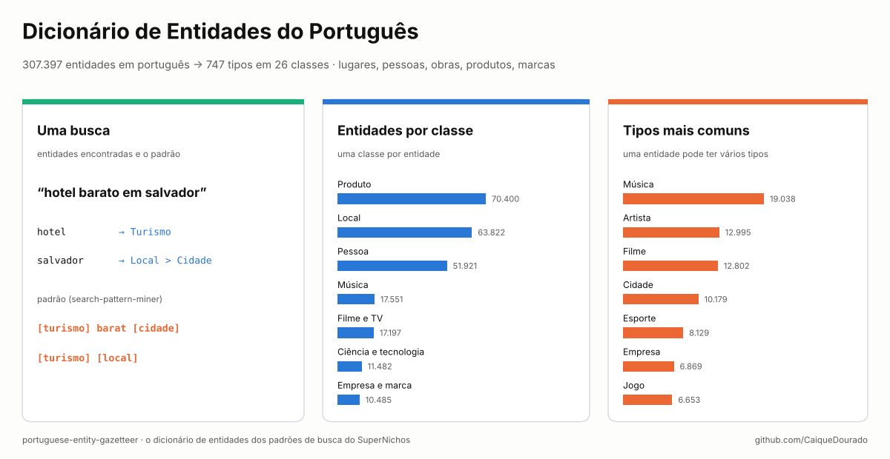
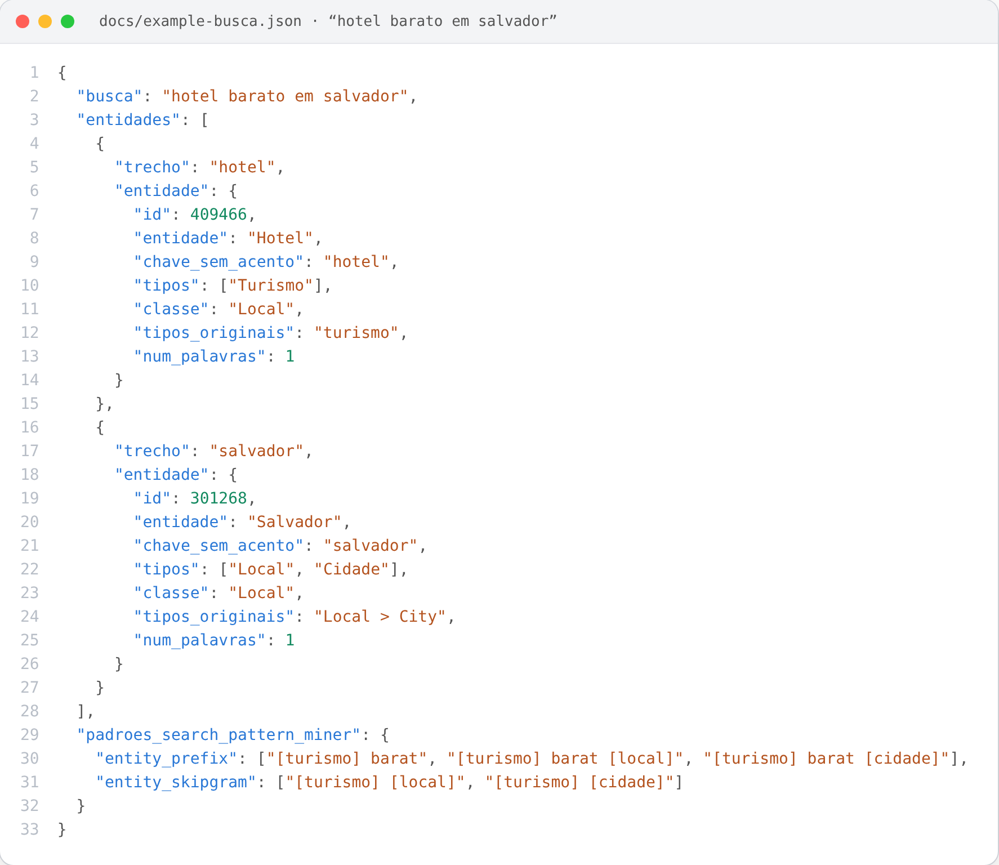
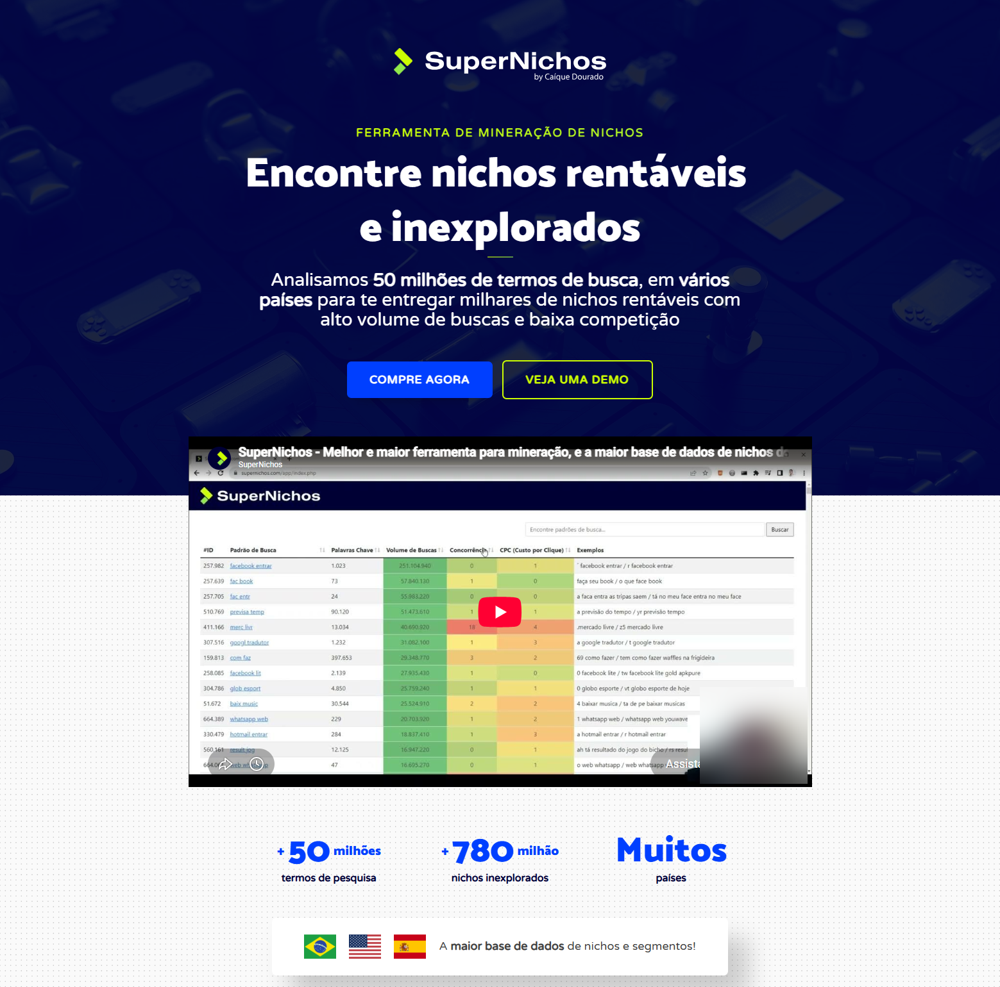
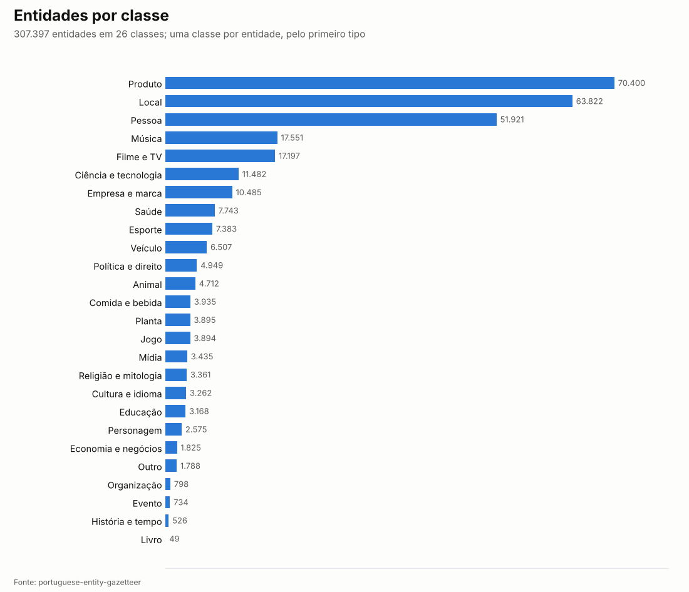
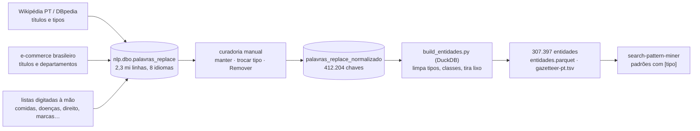

# Dicionário de Entidades do Português · Portuguese Entity Gazetteer

[](https://github.com/CaiqueDourado/portuguese-entity-gazetteer/actions/workflows/validate.yml)
[](LICENSE-DATA.md)
[](LICENSE)
[](https://www.kaggle.com/datasets/caiquedourado/portuguese-entity-gazetteer)

[Read in English](README.md)



Uma lista de **307.397 entidades em português** com seus tipos: lugares, pessoas, filmes, músicas, programas de TV,
produtos, marcas, comidas, doenças, leis, animais, plantas… Cada entidade tem **um ou mais de 747 tipos** (*Salvador*
é `Local > Cidade`, *Neymar* é `Pessoa > Jogador de futebol`) e **uma de 26 classes**. Também vem pronta para o
[search-pattern-miner](https://github.com/CaiqueDourado/search-pattern-miner), que transforma buscas em modelos
trocando as entidades pelo seu tipo:

```text
hotel barato em salvador   →   [turismo] barat [cidade]
```

É o dicionário de entidades que o autor montou e revisou à mão para achar padrões em milhões de buscas do Google, os
padrões por trás do **[SuperNichos.com](https://supernichos.com)** e do
[google-keywords-dataset](https://github.com/CaiqueDourado/google-keywords-dataset).

## O que tem aqui

| Arquivo | Linhas | O quê |
|---|---:|---|
| `entidades.parquet` / `.csv` | 307.397 | uma entidade por linha: a entidade, as chaves de busca, os tipos, a classe e os tipos de origem |
| `tipos.csv` | 747 | cada tipo com sua classe, quantas entidades o têm e as grafias de origem que foram unidas nele |
| `gazetteer-pt.tsv` | 307.397 | `entidade<TAB>tipos`, o formato que o search-pattern-miner lê |
| `stats.json` | | todas as contagens da construção |

Os dados completos estão no [Kaggle](https://www.kaggle.com/datasets/caiquedourado/portuguese-entity-gazetteer);
[`sample/`](sample) tem 50 entidades por classe (1.299; *Livro* tem 49) em CSV e TSV, e o `tipos.csv` inteiro.

| Coluna | Exemplo | O quê |
|---|---|---|
| `id` | 301268 | id na tabela de origem |
| `entidade` | Salvador | a entidade como estava na origem |
| `chave` | salvador | chave de busca, em minúsculas |
| `chave_sem_acento` | salvador | a chave sem acentos |
| `tipos` | Local > Cidade | um ou mais tipos; `>` separa **vários tipos**, não é hierarquia |
| `classe` | Local | uma de 26 classes, pelo primeiro tipo que tem classe |
| `tipos_originais` | Local > City | os tipos antes da limpeza |
| `num_palavras` | 1 | palavras na chave |
| `chave_curta` | false | chave de até 3 caracteres (*SP*, *AMD*, *uva*): case como palavra inteira |

## Como uma busca usa o dicionário



As entidades de *hotel barato em salvador*, procuradas como palavra inteira e com a chave mais longa primeiro, e os
padrões que o search-pattern-miner faz com elas: um padrão por tipo, então `Local > Cidade` dá `[local]` e
`[cidade]`. Arquivo completo: [docs/example-busca.json](docs/example-busca.json), gerado por
[scripts/make_json.py](scripts/make_json.py) a partir das entidades de exemplo em
[docs/entidades-exemplo.csv](docs/entidades-exemplo.csv).

## O site de onde isto vem



O **[SuperNichos.com](https://supernichos.com)** (2023–) vende acesso a milhões de buscas do Google agrupadas em
padrões, para achar nichos de sites novos. Três dos seus algoritmos (Barbosa, Figueredo e Rosa) primeiro trocam as
entidades de cada busca pelo tipo, e assim *apartamentos para alugar em curitiba* e milhares de buscas parecidas
viram `[imovel] par [local]`; **749.693** dos padrões publicados têm pelo menos uma entidade. Este dataset é o
dicionário que eles usavam, limpo.

## O que os dados mostram



- **Produtos, lugares e pessoas são 60%.** 70.400 nomes de produto, 63.822 lugares e 51.921 pessoas. Por tipo,
  10.179 entidades são cidades, 5.094 bairros, 12.995 artistas, 3.527 jogadores de futebol, 2.896 políticos e
  1.314 escritores.
- **Muitas entidades têm vários tipos.** `tipos` guarda todos; `classe` pega o primeiro que tem classe. Por isso
  *Livro* tem só 49 entidades como classe: a maioria dos livros é `Produto > Livro`, classe *Produto*.
- **A maioria das chaves é curta.** 1 palavra: 59.210 · 2: 116.643 · 3: 66.103 · 4: 32.336 · 5 ou mais: 33.105
  (quase todas títulos de produto). 1.588 chaves têm até 3 caracteres.
- **Os tipos estavam bagunçados e foram unidos.** A origem tinha 775 tipos (ignorando maiúsculas), misturando nomes
  em inglês da DBpedia com português, singular e plural, variações de caixa (*Marca*/*marca*, *Film*/*FIlm*); agora
  são 747, cada um com as grafias de origem em `tipos.csv`.

## Como usar

```python
import duckdb

e = "entidades.parquet"      # no Kaggle: /kaggle/input/portuguese-entity-gazetteer/entidades.parquet
duckdb.sql(f"SELECT entidade, tipos, classe FROM '{e}' WHERE chave_sem_acento = 'sao paulo'").show()

# todos os bairros, todas as doenças, todos os clubes…
duckdb.sql(f"SELECT entidade FROM '{e}' WHERE tipos LIKE '%Bairro%' LIMIT 20").show()
```

```python
from search_pattern_miner import Gazetteer, mine   # github.com/CaiqueDourado/search-pattern-miner

gaz = Gazetteer.load("gazetteer-pt.tsv")
mine("receita de bolo de cenoura", gaz, ["barbosa"])     # padrões como "receit [comida]"
```

O [notebook](notebooks/estudo.ipynb) tem mais consultas.

## Como foi feito



- **Fontes.** Títulos e tipos da Wikipédia em português via DBpedia (os nomes de tipo em inglês, *Person*,
  *SoccerPlayer*, *Film*, *River*, vêm da ontologia dela), títulos de produto e nomes de departamento de lojas
  virtuais brasileiras, e listas digitadas pelo autor (comidas, doenças, direito, religião, marcas).
- **Curadoria.** O autor revisou as entidades numa ferramenta interna simples: manter, trocar o tipo ou marcar como
  *Remover*. Este dataset parte da tabela revisada, `nlp.dbo.palavras_replace_normalizado` (412.204 chaves),
  exportada uma vez para Parquet pelo
  [exportar_supernichos.py](https://github.com/CaiqueDourado/google-keywords-dataset/blob/main/scripts/exportar_supernichos.py).
  A tabela sem revisão (2,3 milhões de linhas em 8 idiomas) não é publicada.
- **Construção** ([scripts/build_entidades.py](scripts/build_entidades.py)), vale o primeiro motivo:

  | Etapa | Chaves |
  |---|---:|
  | origem | 412.204 |
  | marcadas *Remover* na curadoria | −99.078 |
  | títulos de produto cortados depois de um conector (*Adaptador Hdmi Para*, *Armani Code Eau de*) | −4.833 |
  | páginas de lista da Wikipédia (*lista de praias da bahia*) | −421 |
  | tipo *Colocar*, "a classificar", nunca classificado | −213 |
  | 1–2 caracteres, menos as 27 siglas de estado (*SP*, *RJ*…) | −133 |
  | só números, menos anos com tipo *Ano* | −52 |
  | instituições com tipo de pessoa, comida, planta… (*universidade paulista* como *Person*) | −28 |
  | sem letra nem número | −2 |
  | chaves iguais exceto pela caixa, unidas com os tipos somados | −47 |
  | **entidades** | **307.397** |

  Os tipos foram limpos: espaços tirados, nomes em inglês da DBpedia traduzidos (*Person* → *Pessoa*, *City* →
  *Cidade*), variações de caixa e de plural unidas, pedaços como *de* e *e* (sobras de um `>` digitado dentro de um
  nome) descartados. Cada tipo foi ligado à mão a uma de 26 classes.

## Limitações

- **Palavras comuns como entidade.** *brasil* é `Animal`, *casa* é `Local > Imóvel`, *love* é `Pessoa`: o dicionário
  foi feito para trocar palavras dentro de buscas, e esses eram os tipos que funcionavam lá. Confira o tipo antes de
  confiar num casamento de uma palavra só.
- **Ainda há rótulos errados** na cauda longa (*bandeira de blumenau* como *Comida*), embora a curadoria e a
  construção tenham tirado os piores.
- **Não é só português.** Nomes de filme, música e banda vêm muito em inglês, e há lugares do mundo todo.
- **Sem desambiguação.** Uma linha por chave: *salvador* tem os tipos da cidade, não do nome.
- **Títulos de produto** são nomes de anúncios de lojas virtuais brasileiras, com marcas; ficam como foram achados.
- **Pessoas** vêm de títulos da Wikipédia e da DBpedia. Se você é uma delas e quer seu nome fora, abra uma issue.

## Relacionados

- Artigo: [Treinando o Stanford NER em português com um dicionário](https://github.com/CaiqueDourado/articles/blob/main/stanford-ner/README.pt-BR.md) ([em inglês no Medium](https://medium.com/@caiquedourado/training-stanford-ner-on-portuguese-with-a-dictionary-e3fcdee53bcd)): o que um modelo treinado com este dicionário aprende além dele.
- [search-pattern-miner](https://github.com/CaiqueDourado/search-pattern-miner): os algoritmos que usam este dicionário (Python e .NET).
- [google-keywords-dataset](https://github.com/CaiqueDourado/google-keywords-dataset): os 1,73 milhão de padrões de busca feitos com ele ([Kaggle](https://www.kaggle.com/datasets/caiquedourado/google-keywords-dataset)).
- [dicionario-portugues](https://github.com/CaiqueDourado/dicionario-portugues): 272 mil palavras do português, o lado das palavras comuns.
- [municipios-e-estados-do-brasil](https://github.com/CaiqueDourado/municipios-e-estados-do-brasil): a lista oficial de municípios, para conferir os lugares.

## Licença

Os dados são [CC BY-SA 4.0](LICENSE-DATA.md), porque parte vem da Wikipédia e da DBpedia (CC BY-SA). Código:
[MIT](LICENSE). Pedidos de remoção: abra uma issue.

## Autor

**Caique Dourado**: 20 anos construindo crawlers, pipelines de dados e SEO programático em .NET e SQL Server. Mais em [github.com/CaiqueDourado](https://github.com/CaiqueDourado).
